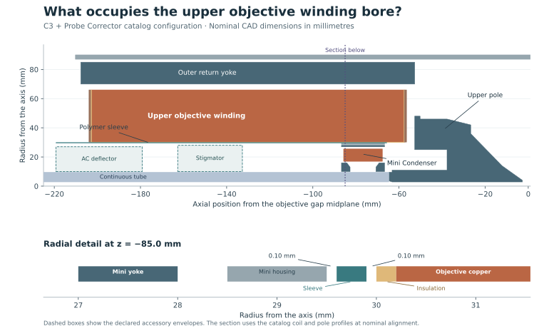

# Coil bores and nested objective hardware

Catalog audit, 20 November 2026. All dimensions are nominal millimetres. Diameters are marked Ø. Radial clearance is measured on one side at the same axial position. Axial coordinates in the objective tables are relative to the middle of the pole gap, with positive Z downstream.

## The photographed assembly and the current CAD

In the supplied cutaways, the owner identifies the lower unit in photograph 2 as the upper objective and the upper unit as a condenser of unspecified stage. Photograph 1 provides another view of the magnetic body around the copper. Photographs 3 and 4 show the wired polymer carrier and its central opening. The owner identifies the Mini Condenser, beam shift/tilt coils and condenser stigmator as occupants of this carrier.

The owner identifies all three windings in the separate Tecnai TF30 stack in frames 121–122. From the top they are the C2 lens, upper objective and lower objective. The lower winding sits in a magnetic and heat-conducting part, and the indicated intermediate passages carry cooling water. [TF30 winding and metalwork measurements](tecnai-tf30-photo-dimensions.md#identified-windings-and-metalwork)

The owner confirms that the **sleeve outer surface fits closely in the bore of the assembled upper objective** and that **the vacuum tube passes inside the sleeve**. The fit clearance, the tube's actual OD and ID, and the spacing between the tube and the sleeve are unknown. The cutaways establish the presence of magnetic material inboard of the winding. Its radial profile and axial span remain undimensioned.

Two features in the catalog need reconciliation with this assembly.

1. The model places a Ø59.8 sleeve inside a Ø60.0 objective winding envelope. The 0.10 mm radial distance refers specifically to those two modeled surfaces. The confirmed close fit is to the bore of the assembled upper objective. That mating surface has no independent diameter in the CAD. The modeled objective return yoke is Ø140 inside and Ø170 outside, beyond the Ø132 winding OD. The upper pole stem enters the winding for 7.0 mm at its downstream end.
2. The sleeve declaration contains `mini_condenser`, `condenser_stigmator` and the **AC Scan Coil** (`ac_deflector`). The separately driven **BSh/BTlt Beam Shift/Tilt Deflector** (`beam_deflector`) is upstream in all seven catalogs. Its saved package OD is 90. Its modeled windings and supports reach Ø47.0 in the probe-only corrector configuration and Ø45.2 in the other six. Those material diameters fit inside an isolated Ø59.2 opening. Placement, other occupants and the actual carrier still determine whether the photographed assembly can be reproduced. [Sleeve occupants and nominal clearance rules](../../src/temsim/cad_objective_sleeves.py) · [Beam Shift/Tilt and AC ownership](../../src/temsim/optics/ac_deflector.py)

### One radial section through both lenses

At Z = −85.0 in the probe-only corrector configuration, the following material bands occur at the same axial station. This section cuts the Mini Condenser upper pole and winding inside the upper objective winding. Dimensions are from the native material profiles. [Column configuration](../../configs/instruments/column/C3_ProbeCorrector.toml)

| Material at Z = −85.0 | ID | OD |
| --- | ---: | ---: |
| Continuous vacuum tube (reconstruction inputs) | 5.76 | 19.2 |
| Mini Condenser pole | 20 | 32 |
| Mini Condenser winding | 34 | 51 |
| Mini Condenser yoke | 54 | 56 |
| Mini Condenser housing | 57 | 59 |
| Removable upper sleeve | 59.2 | 59.8 |
| Upper objective inner insulation | 60.0 | 60.4 |
| Upper objective copper pack | 60.4 | 132 |
| Objective outer return yoke | 140 | 170 |
| Objective housing | 174 | 180 |

The radial fit is 0.40 from tube to Mini Condenser pole, 0.10 from Mini Condenser housing to sleeve, and 0.10 from sleeve to objective insulation. The upper copper surface is 0.30 from the sleeve in this configuration, including 0.20 of solid insulation. The other six configurations model a bulk winding beginning at Ø60.0. The sleeve wall is 0.30 thick. In the sections occupied by the condenser stigmator and the AC coil, their Ø56 and Ø54 package envelopes leave 1.60 and 2.60 inside the sleeve. The Ø96 maximum objective pole flange lies outside the winding's axial span. The beam continues through the smaller Ø5.76 pole bore at the objective. [Upper and lower pole sections](objective-pole-piece-dimensions.md)

### Which sections physically overlap

The recorded objective winding has two material intervals, −202.7 to −57.7 and +57.7 to +202.7. The Mini Condenser copper occupies −85.7 to −67.7. Its entire 18.0 mm length lies within the upper interval. This is the only pair of different round-lens windings with positive axial overlap in any catalog module. The coil record's single display span crosses the gap and would give incorrect overlap results. [Winding interval resolver](../../src/temsim/cad_round_winding.py)

| Column catalog selection | Upper sleeve Z | Upper sleeve / winding axial overlap | Lower sleeve / winding axial overlap | Beam Shift/Tilt downstream end to upper sleeve entrance |
| --- | --- | ---: | ---: | ---: |
| Two-condenser column | −163.7 to −65.7 | 98.0 | 71.0 | 46.5 |
| Three-condenser column without correctors | −163.7 to −65.7 | 98.0 | 71.0 | 51.5 |
| Three condensers + Image Corrector | −163.7 to −65.7 | 98.0 | 71.0 | 51.5 |
| Three condensers + B-COR | −163.7 to −65.7 | 98.0 | 71.0 | 51.5 |
| Three condensers + Probe Corrector | −219.2 to −65.7 | 137.0 | 97.0 | 320.0 |
| Three condensers + Probe Corrector + Image Corrector | −163.7 to −65.7 | 98.0 | 71.0 | 375.5 |
| Three condensers + Probe Corrector + B-COR | −219.2 to −65.7 | 137.0 | 71.0 | 320.0 |

The sleeve ends at Z = −65.7, 1.0 before the upper pole stem starts. For the two 137.0 mm overlaps, only 23.5 of the AC package's 40.0 overlaps the upper winding. All 40.0 overlaps it in the other five selections. The 30.0 condenser stigmator and the 20.0 Mini Condenser package overlap the upper winding in every selection. The lower sleeve has the same ID and OD and surrounds the objective stigmator and shared image/diffraction deflector. Its different axial registration is separate from the mirror symmetry of the objective pole pair.

## Round-lens inventory

The 13 catalog module choices comprise three guns, one optional blanker, seven columns and two recording systems. Expanding both recording systems gives 78 round winding records across those alternative modules and 20 distinct round-lens owners. Each row below groups owners with the same indicated bore dimensions. The pole bore is the minimum diameter of the actual revolved section. An inserted aperture or a narrower tube can further limit the beam. [Catalog](../../configs/instruments/catalog.toml) · [Native pole geometry](../../src/temsim/pole_geometry.py)

| Lens or group | Winding ID | Minimum pole bore | What occupies the bore |
| --- | ---: | ---: | --- |
| C1 lens and C2 lens | 96 | 19.2 | Shared Ø90.75 OD / Ø60 ID cartridge. Its separation from the winding is 2.625 per side. The Ø60 pole roots seat in the cartridge. The Ø19.2 tube and pole bore have zero nominal radial clearance at coincident sections. |
| C3 lens | 96 | 18 | Ø92 pole root. The tube OD drops to 17.2, giving 0.40 radial clearance along the cylindrical section and 0.398 minimum distance at the tube ramp. |
| Mini Condenser | 34 | 20 | Ø32 pole roots around the Ø19.2 tube. The outside of the complete housing reaches Ø59. |
| Upper and lower objective, one shared winding record | 60 | 5.76 | Two axially separated coil packs. Each overlaps the Ø19.2–22 stem end of its pole. The upstream tube ends against the upper pole. |
| Probe adapter, TL12, TL21 and TL22 | 78.33 | 20 | Ø66.33 pole roots. Ø19.2 local tube OD leaves 0.40 at the poles. |
| Image TL11 | 115.18 | 20 | Ø103.18 pole roots. |
| Image TL12 | 85.70 | 13 | Ø73.70 pole roots. |
| Image TL21, TL22 and B-COR TL31, TL32 | 75 | 13 | Ø62.645 pole roots. |
| Image adapter | 75 | 13 | Ø58.96 pole roots. |
| Diffraction | 60 | 40 | The entrance return lip has a Ø66 opening. The downstream sleeve has a Ø40 bore and joins the intermediate lens. |
| Intermediate and projector 2 | 60 | 21.5 | The Ø21.5 OD liner meets the narrow pole faces at zero nominal radial clearance. The intermediate sleeve has a Ø40 straight bore. The projector 2 exit sleeve opens to Ø44. |
| Projector 1 | 60 | 40 | Two Ø40 ID sleeves bound an axial opening 40 mm long. Both recording selections use the same iron profiles. [Recording-stage sections](post-specimen-lens-geometry.md) |

The continuous upstream tube has Ø5.76 ID. At the Mini Condenser, AC and condenser stigmator centers, the assembled beam-wall model resolves Ø5.76. At the separate Beam Shift/Tilt center it resolves Ø5.0. At the diffraction lens center it resolves Ø20.0. Aperture working holes are separate local restrictions. [Tube profile and resolved beam boundaries](cad-vacuum-tube.md)

## Deflectors, stigmators and correctors

For saddle and multipole windings the first diameter below is twice the smallest radial distance from the axis to the **allocated winding pack**. Individual loops occupy selected angles and axial stations. The second diameter is the saved mechanical clear-bore value. Component supports, other occupants and vacuum tubes have separate surfaces. The audit counted 37 distinct auxiliary winding keys across the variants, including explicitly modeled correction windings at shared optical references.

| Device or group | Winding inner tangent Ø | Declared local bore Ø |
| --- | ---: | ---: |
| FEG and thermionic gun deflectors | 16.40 | 10 |
| FEG and thermionic gun stigmators | 32.00 | 10 |
| Condenser deflector and Beam Shift/Tilt | 25.60 | 20 |
| AC scan and shared image/diffraction deflector | 22.72 | 20 |
| Condenser and objective stigmators | 30.08 | 20 |
| Probe HP1 and HP2 | 45.42 | 20 |
| Probe QPH1, QPH2, HPC, QPC, HPol and QPol | 38.70 | 20 |
| Probe DP11, DP21, DP22, DPH1 and DPH2 inserts | 22.20 | 20 |
| Image HP1, HP2 and B-COR HP3 | 56.16 | 8 |
| Image HPol and QPol | 51.80 and 40.40 | 20 |
| Image DP11, DP12, DP21, DP22, ISH and DSH inserts | 22.20 | 20 |
| Image DPH1 and DPH2 inserts | 52.00 | 8 |
| Diffraction stigmator | 48.00 | 20 |

A centered CAD gauge through the probe-only configuration's individual devices gives Ø25.00 through the Beam Shift/Tilt supports, Ø22.32 through the AC supports and Ø20.00 through the condenser stigmator carrier. The objective stigmator winding geometry admits Ø30.08 before accounting for other components. The gun stigmators' slotted carriers admit Ø10.00. The open space between an isolated set of windings and the working beam diameter can differ substantially. [Transverse winding geometry](../../src/temsim/transverse_winding.py) · [Ordinary deflector supports](../../src/temsim/ordinary_deflector_geometry.py)

The Probe DPH insert is Ø22.12 inside / Ø23.88 outside including its laminate. The surrounding Probe HP pole-tip circle is Ø24.0, leaving a nominal 0.06 radial fit. On the image side, a Ø52–54 DPH pack shares axial space with six angularly separated HP pins. Open CASCADE checks of the pins against the occupied saddle packs gave zero intersection and minimum distances of 2.638 for HP1/DPH1 and 0.272 for HP2/DPH2 in all four image-corrector selections. Comparing those insert ODs directly with the Ø8 central opening would misclassify the assembly. [Corrector pin geometry](../../src/temsim/cad_multipoles.py) · [Insert laminate dimensions](../../src/temsim/deflector_support_geometry.py)

The optional FEG Wien unit exposes an Ø8 mechanical bore. The ten optional energy-filter multipole carriers each expose Ø15 on their local bent-path frames. Their winding IDs have no independent dimensions in the native CAD. The sector prism has a 30 mm pole gap. The electrostatic gun lenses and optional plate blanker have no round excitation winding to count. [Branch and gun CAD](../../src/temsim/cad_auxiliary.py)

## Dimensional status and evidence

The upper sleeve's mating surface and the presence of the inner vacuum tube are recorded as assembly evidence. The magnetic profile, numerical fit, tube diameters and axial station of the photographed shift/tilt windings remain open. The model currently uses Ø19.2 OD and Ø5.76 ID for the tube through the sleeve, based on the earlier connector scaling and assumed bore ratio. The source photographs are identifiable by their supplied file stems, in order, `4e37c902d1a47e9e0699b4c5cfdeb76b`, `48720fba82e187bcc17c38599a918bb5`, `cd7730db1dfae606238ab222d1361459` and `98e90d59125e6480248814cf00187a90`.

Run `python scripts/audit_coil_bores.py` at the repository root for the per-module winding and pole dimensions, material intervals, sleeve overlaps and shift/tilt locations. The CAD gauge and interference figures above refer to the named pairs in their nominal poses. [Audit script](../../scripts/audit_coil_bores.py)
