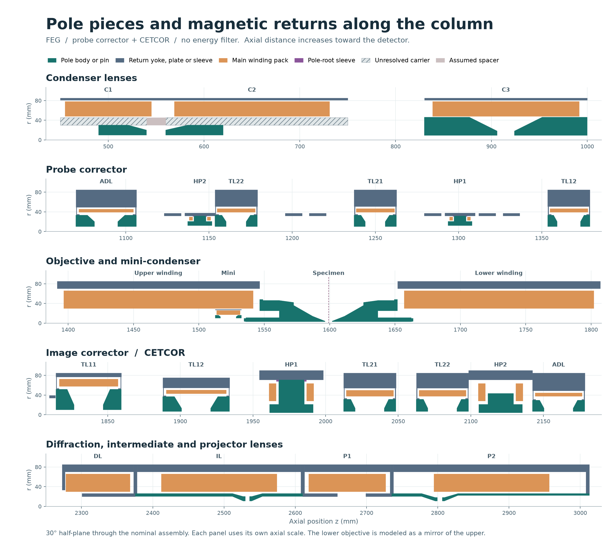
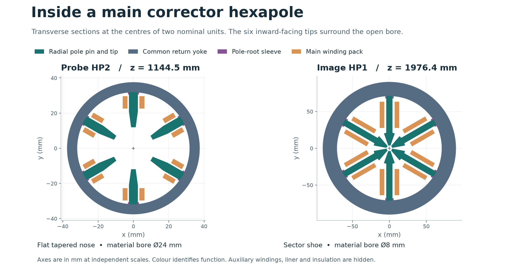
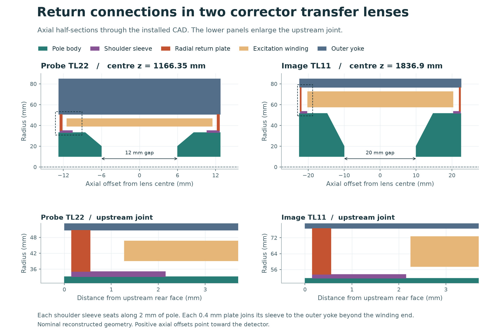

# Where the pole pieces and magnetic returns sit

The five supplied views locate the upper objective pole, its annular rear recess and its hollow tail. The two strongest independent clues elsewhere are the previously identified shared condenser cartridge and the published photograph of a CEOS probe hexapole. The following map places those features in the simulator and identifies the iron that still needs an instrument-specific section or material record. [Upper objective photo reconstruction](../objective-pole-piece-dimensions.md) · [Condenser cartridge photo audit](../condenser-pole-piece-tails.md) · [Müller et al., Figs. 2–3](https://www.ceos-gmbh.de/en/produkte/stemkorrektoren/dcor-ascor/Mueller2006a.pdf#page=3)

**Coordinate convention.** All distances are nominal millimetres. Global *z* starts at the electron source and increases toward the detector. Radius *r* is measured from the beam axis. Both STEP files use the field-emission gun (FEG), C3 lens and unfiltered recording system with no beam blanker. In both, the specimen centre is at **1599.2 mm**. The figures use the assembly with CETCOR, which adds 426 mm downstream of the specimen. [Default probe-corrected STEP](default-probe-column-iron.step) · [Probe and CETCOR STEP](double-corrected-column-iron.step) · [Default column configuration](../../../configs/instruments/column/C3_ProbeCorrector.toml) · [Double-corrected configuration](../../../configs/instruments/column/C3_ProbeCorrector_ImageCorrector.toml)

## Which lens centres contain a flux guide?

A useful mechanical test is to cut at the winding centre and examine the first magnetic body outside the beam tube. A straight sleeve carries flux along the bore. Opposing, narrowed faces bound a working gap. A cylindrical outer yoke returns flux at a larger radius. These features can occupy different axial stations within the same lens.

| Station in the model | What is at the beam side of the central section? | Where is the winding? |
| --- | --- | --- |
| C1 lens and C2 lens | At *z* = 500 the C1 lens pole surrounds the tube. At 650 the C2 lens has a carrier of unresolved composition. The two separately modeled pole faces are at 540 and 560 in the shared cartridge. | Two independent packs at 455–545 and 569–731, both at *r* = 48–78. |
| C3 lens, Mini, probe ADL/TL and image ADL/TL | A gap separates the annular upper and lower poles at each lens centre. | A concentric winding surrounds each gap at larger radius. Each of these round lenses has its own excitation. |
| Objective | The opposed pole noses surround a 5.4 mm specimen gap. On each side, the nose is a passive flux guide in a region free of the main winding. | The two main packs occupy 1396.5–1541.5 and 1656.9–1801.9. The upper pole starts in the axial span of the first pack, at smaller radius. |
| Diffraction lens (DL) | Straight sleeve, *r* = 20–26 at the winding centre. It continues into the intermediate lens. | Farther out, *r* = 30–66. |
| Intermediate lens (IL) | The same sleeve section, *r* = 20–26 at the winding centre. Its narrow pole gap is **40 mm downstream** of that centre, measured to the gap midpoint. | Independent outer winding, *r* = 30–66. |
| First projector lens (P1) | A **40 mm opening** between two sleeves, centred 6 mm downstream of the winding centre. | Independent outer winding, *r* = 30–66. |
| Second projector lens (P2) | Exit sleeve, *r* = 22–26 at the winding centre. The narrow pole gap is **72.5 mm upstream** of that centre. | Independent outer winding, *r* = 30–66. |

DL, IL and P2 therefore have a sleeve at the beam side of **their winding centres**. The beam travels through the hole inside these sleeves. All four recording lenses have driven windings. The Philips CM12/STEM section identifies the four stages. The CM100/120 service manual identifies DL and IL hardware in one mechanical unit and separate P1 and P2 coil carriers in a second unit. The shared return, sleeve joins and short working-gap positions in this atlas are the project's reconstruction. Their applicability to the photographed instrument requires its internal drawing. [Philips CM12/STEM, Fig. 5](https://www.worldradiohistory.com/Archive-Company-Publications/Philips-Technical-Review/80s/Philips-Technical-Review-1987-11.pdf#page=10) · [CM100/120 Mechanics, §5.24 and Fig. 810](https://www.scribd.com/document/516569721/CM-100-120-Mechanics) · [Projector iron profiles and evidence](../post-specimen-lens-geometry.md)

## Round pole positions

The limits below are material faces. Each opposed pair has a beam hole. On the probe side the ADL is the entrance adapter lens, TL denotes a round transfer lens, and Mini is the mini-condenser. The CEOS probe design can use the mini-condenser for the TL11 function. The selected simulator column has one Mini and one downstream probe TL12. [CEOS probe layout, pp. 443–444](https://www.ceos-gmbh.de/en/produkte/stemkorrektoren/dcor-ascor/Mueller2006a.pdf#page=2)

| Lens or shared unit | Upstream pole body, global *z* | Downstream pole body, global *z* | Separation between faces |
| --- | ---: | ---: | ---: |
| C1 lens / C2 lens cartridge | 490–540 (C1 lower) | 560–620 (C2 upper) | 20 |
| C3 lens | 830–906 | 924–1000 | 18 |
| Probe ADL | 1070–1081.2 | 1095.2–1106.4 | 14 |
| Probe TL22 | 1153.6–1160.35 | 1172.35–1179.1 | 12 |
| Probe TL21 | 1237.2–1243.95 | 1255.95–1262.7 | 12 |
| Probe TL12 | 1353.6–1359.3 | 1373.3–1379 | 14 |
| Mini | 1512.5–1516.5 | 1528.5–1532.5 | 12 |
| Objective | 1534.5–1596.5 | 1601.9–1663.9 | 5.4 |
| Image TL11 | 1814.4–1826.9 | 1846.9–1859.4 | 20 |
| Image TL12 | 1887.9–1900.9 | 1920.9–1933.9 | 20 |
| Image TL21 | 2012.4–2020.4 | 2040.4–2048.4 | 20 |
| Image TL22 | 2062.4–2070.4 | 2090.4–2098.4 | 20 |
| Image ADL (CETCOR) | 2142.4–2150.4 | 2170.4–2178.4 | 20 |

The upper objective joins the tube at **1534.5**. Its side and rear views support a short hollow stem, a recessed flange and a compound cone toward the specimen. The lower pole uses the same full section reflected across the specimen midplane at **1599.2**, including the Ø5.76 minimum passage. The lower geometry follows the owner's symmetry assumption. The tube alloy, any intervening sealing layer and the connection to the outer magnetic return are unknown. The CM100/120 provides one documented example of an indium seal at the upper lining tube to pole joint. [Objective pole pair and evidence](../objective-pole-piece-dimensions.md) · [Section of both poles](../objective-pole-pair-section.svg) · [CM100/120 Mechanics, §§5.4 and 5.11.1](https://www.scribd.com/document/516569721/CM-100-120-Mechanics)

In the shared C1 lens / C2 lens cartridge the 20 mm pole gap occupies **540–560**. The winding-free interval occupies **545–569**. The separator lies at *r* = 30–45.375 around the pole gap. The earlier cartridge photographs show an internal taper and a side port. The native pole solids have straight bores and exterior tapers. The composition of the carrier sections on either side of the separator still requires a section or a materials record. [Photo and CAD comparison of the shared cartridge](../condenser-pole-piece-tails.md)

The recording-local distances start at the entrance of the recording module. The last column gives the coordinates in the default probe-corrected STEP. A shared endpoint in the second column is a join between separately selectable solids.

| Unit | Beam-side bodies, recording-local *z* | Opening or join, recording-local *z* | Default global *z* |
| --- | --- | --- | --- |
| DL | Entrance return lip 32.5–36.5 and straight sleeve 60–135 | The lip and sleeve have different bore diameters. The sleeve joins IL at 135. | Lip 1846.9–1850.9, sleeve 1874.4–1949.4, winding centre 1896.9. |
| IL | Upper sleeve and pole 135–289.5, lower pole and sleeve 295.5–370 | Narrow gap 289.5–295.5. | Gap **2103.9–2109.9**, winding centre 2066.9. |
| P1 | Upper sleeve 370–418.5, lower sleeve 458.5–495 | Wide opening 418.5–458.5. | Opening **2232.9–2272.9**, winding centre 2246.9. |
| P2 | Upper sleeve and pole 495–559, lower pole and exit sleeve 566–772.5 | Narrow gap 559–566. | Gap **2373.4–2380.4**, winding centre 2449.4. |

Four outer yokes surround the four independently driven windings. In the default column the shared return plates span 1946.9–1951.9 at DL/IL, 2181.9–2186.9 at IL/P1 and 2306.9–2311.9 at P1/P2. A fourth plate closes the P2 exit at 2581.9–2586.9. A service section through those interfaces would locate the actual boundaries between carriers and iron. [Downstream assembly and detailed sections](../post-specimen-lens-geometry.md)

The following registration points cover the seven column variants with the same FEG and unfiltered recording module. Add the recording entrance to any recording-local coordinate above to locate that feature in a chosen column. [Column catalog](../../../configs/instruments/column) · [Recording configuration](../../../configs/instruments/project_and_recording_system/NoEnergyFilter.toml)

| Installed column | Specimen centre, global *z* | Recording entrance, global *z* |
| --- | ---: | ---: |
| C1 lens and C2 lens | 1025.2 | 1240.4 |
| C3 lens | 1275.2 | 1490.4 |
| C3 lens + probe corrector (default) | 1599.2 | 1814.4 |
| C3 lens + CETCOR | 1275.2 | 1916.4 |
| C3 lens + B-COR | 1275.2 | 2060.4 |
| C3 lens + probe corrector + CETCOR (figures) | 1599.2 | 2240.4 |
| C3 lens + probe corrector + B-COR | 1599.2 | 2384.4 |

## Magnetic parts inside the spherical-aberration correctors

The probe-side sequence toward the specimen is **ADL → HP2 → TL22 → TL21 → HP1 → TL12 → Mini → upper objective** when listing the main lenses and hexapoles. The two central transfer lenses have their own opposed round poles. At each HP station six radial pins point toward the axis, with a winding around each pin and a common return yoke around the outside. The CEOS paper identifies six ferromagnetic pins and a nickel–iron alloy for its photographed CESCOR. Its Ø152 yoke, Ø8 pole bore and 30 mm axial pole length belong to that published device. The simulator's two probe hexapoles use the dimensions below. [Müller et al., p. 443 and Fig. 3 on p. 444](https://www.ceos-gmbh.de/en/produkte/stemkorrektoren/dcor-ascor/Mueller2006a.pdf#page=3)

| Station | Centre *z* | Axial limits of the six pole noses | Axial limits of the outer return ring | Radial section in the model |
| --- | ---: | ---: | ---: | --- |
| Probe HP2 | 1144.50 | 1137.22–1151.78 | 1135.4–1153.6 | Flat tapered noses begin at *r* = 12. Return ring *r* = 31.89–37.5. |
| Probe HP1 | 1300.85 | 1293.61–1308.09 | 1291.8–1309.9 | Same radial section as probe HP2. |
| Image HP1 | 1976.40 | 1961.4–1991.4 | 1954.4–1998.4 | Sector shoes span *r* = 4–21.2. Return ring *r* = 71.08–90. |
| Image HP2 | 2120.40 | 2105.4–2135.4 | 2098.4–2142.4 | Same radial section as image HP1. |

**Probe pole shape.** Each nose widens tangentially from 2.448 to 4.896 over a radial run of 8.925, then joins a straight radial core. The six pin axes are 60° apart. The main winding packs lie along those cores, between radial coordinates 22.71 and 29.595 on a pin centreline. At the HP stations the DPH1/DPH2 steering windings occupy a separate layer in the material bore. [Probe HP geometry](../cad-probe-corrector.md) · [Installed pin and winding shapes](../../../src/temsim/cad_multipoles.py)

**Image corrector.** The main sequence toward the detector is **TL11 → TL12 → HP1 → TL21 → TL22 → HP2 → ADL**. The native image HP has a 39° sector shoe joined to a radial stem. The main winding packs lie along the stems and separate DPH steering conductors are allocated at *r* = 26–27 between the pins. CEOS documents the station sequence and the pin/coil/yoke construction family. The sector profile, radial dimensions, installed angles and joints are engineering choices. [CEOS image-corrector layout, slide 26](https://www.ceos-gmbh.de/de/grundlagen/Workshop-Beitraege/01_How-do-aberration-correctors-work-pdf.pdf#page=26) · [Müller et al., Fig. 5 and accompanying author text](https://www.researchgate.net/figure/Boundary-representation-of-a-single-hexapole-element-with-yoke-pole-pins-and-coils_fig5_243652744) · [Image winding positions](../cad-image-corrector-channels.md)

In the double-corrected STEP, pin 1 is at 30° in probe HP2, 27.57° in probe HP1, 30° in image HP1 and −84.66° in image HP2, measured from +*x* towards +*y*. The default probe column places pin 1 of HP1 at 27.59°. The other five pins in each unit follow at 60° intervals. These angles describe the saved assembly orientation.

Each principal hexapole now has **six individual pole-root sleeves**. A rectangular opening fits over each pin stem between the outer end of its winding and the inner wall of the common yoke. The outer end of each sleeve follows the cylindrical yoke surface. The saved probe sleeves have 1.2 mm radial depth and 0.55 mm wall thickness. The image sleeves have 3 mm depth and 1.5 mm walls. The pole tips stay separate at the bore. These sleeve dimensions and joints are nominal reconstruction choices. The published photograph establishes the six pins, their windings and the common yoke. [Müller et al., Fig. 3](https://www.ceos-gmbh.de/en/produkte/stemkorrektoren/dcor-ascor/Mueller2006a.pdf#page=3)

Each corrector adapter and round transfer lens contains **one shoulder sleeve and one radial return plate at each end**. The sleeve fits over 2 mm of the pole shoulder, has a 2 mm radial wall and starts 0.15 mm inboard of the rear face. A 0.4 mm thick annular plate spans the distance from the outside of that sleeve to the inner wall of the outer yoke, beyond the excitation winding. The upstream and downstream components are separate. The gap between the two pole faces stays open. Probe TL22 illustrates a shoulder radius of 33.165 mm and a yoke inner radius of 50.755 mm. Image TL11 has corresponding radii of 51.59 and 76.699 mm. In the default CAD these dimensions specify mating material surfaces. Fit tolerance, joint permeability and the alloy of a physical instrument require drawings or measurements. [Round lens material definitions](../../../src/temsim/cad_round_lenses.py) · [Hitachi magnetic lens cross sections, Figs. 6–8](https://patents.google.com/patent/JP2967966B2/en)

| Corrector family | Principal hexapoles with six root sleeves each | Round lenses with two shoulder sleeves and two radial return plates each | Independent auxiliary return sleeves |
| --- | --- | --- | --- |
| Probe | HP2, HP1 | ADL, TL22, TL21, TL12 | Six at QPH2, HPC, QPC, QPH1, HPol and QPol |
| Image (CETCOR) | HP1, HP2 | TL11, TL12, TL21, TL22, ADL | One shared by HPol and QPol |
| Image (B-COR) | HP1, HP2, HP3 | TL11, TL12, TL21, TL22, TL31, TL32, ADL | One shared by HPol and QPol |

**B-COR option.** In the probe + B-COR column, the first two image HP centres remain at 1976.4 and 2120.4. The model inserts TL31 with faces at 2164.4 and 2184.4, TL32 with faces at 2214.4 and 2234.4, and HP3 centred at **2264.4**. Its nominal nose span is 2249.4–2279.4 and its yoke spans 2242.4–2286.4. The exit ADL moves to 2304.4 with faces at 2294.4 and 2314.4. In either image-corrected column without the probe corrector, subtract 324 from the image corrector and specimen coordinates above. The manufacturer's three-hexapole topology supports the additional station. The model reuses the image-family pin profile for HP3. [B-COR assembly](../../../configs/instruments/column/C3_ProbeCorrector_BCOR.toml) · [CEOS B-COR poster](https://www.ceos-gmbh.de/user/pages/02.products/Poster-internet.pdf) · [CEOS patent, Figs. 1–2](https://patents.google.com/patent/EP1941531A2/en)

## Where physical evidence is still needed

| Location | Established in this model or from public evidence | Open mechanical question |
| --- | --- | --- |
| Probe QPH2, HPC, QPC, QPH1, HPol and QPol | Their nominal centres are 1128.15, 1200.85, 1215.35, 1284.50, 1317.20 and 1331.75 respectively. Each station has copper windings and a concentric passive outer sleeve with 64 mm ID and 74 mm OD. | An instrument section would establish any individual pole cores, the mount and the actual return contacts. |
| Image HPol, QPol and DSt | In the illustrated CETCOR, the HPol and QPol windings share *z* = 1811.9 and one selectable passive sleeve with 68 mm ID and 78 mm OD. DSt is an optical reference at 2226.4. | Auxiliary pole counts and the DSt hardware are unresolved. HP3 in B-COR uses six winding packs with unknown individual turns. |
| DPH, DP and the scan coils | DPH steering windings are co-located with their HP. DP stations have separate conductor allocations where specified. Probe DP12 is a control reference to the AC scan coils. | An internal axial section or assembly drawing would settle which surrounding magnetic parts these windings share. |
| Gun, condenser, objective and diffraction stigmators | Their station centres are 433, 1451.5, 1746.9 and 2265.4 respectively in the illustrated column. The diffraction stigmator is at 1839.4 in the default probe configuration. | The presence or number of separately machined iron poles cannot be read from the number of winding channels. |
| Relay lens and objective returns | The CAD includes the shoulder-to-yoke route for the four probe and five CETCOR round lenses and the two additional B-COR lenses. At each objective shoulder, a nominal Ø90/100 mm sleeve and Ø100/140 mm plate connect the flange to the yoke. | The joint geometry, contact reluctance and alloy of the physical instrument require measurements. |

## Pole materials

In **Model Inspector → Pole materials**, select the installed objective, probe corrector or image corrector. Select a component family and then one component or all listed components. The upper and lower round-lens returns can be assigned independently. Each hexapole stage groups its six pole pins and its six root sleeves separately. Saving updates the selected column variant. The shipped pole grade is recrystallization-annealed ARMCO pure iron.

**Open datasheet (PDF)** opens the manufacturer's document for the selected grade in the default browser. The same link is available beside the nonlinear B–H material selector and in the 3D part editor's **Materials** tab. In an archived column, the pole material link follows the saved assignment.

| Solid grade | Last digitized H (A/m) | Last digitized B (T) | Manufacturer curve |
| --- | ---: | ---: | --- |
| ARMCO Pure Iron | 17,000 | 1.996 | [Cleveland-Cliffs, Fig. 7, printed p. 6](https://www.aksteel.nl/files/downloads/clf_productdata__armco_pure_iron_pdb_euro_final_072022_92.pdf) |
| VACOFLUX 50 | 15,900 | 2.293 | [VAC, Static Initial Curve](https://vacuumschmelze.com/03_Documents/Brochures/Datasheet%20%20VACOFLUX%2050.pdf) |
| PERMENORM 5000 H2 | 995 | 1.514 | [VAC, Static Initial Curve](https://vacuumschmelze.com/03_Documents/Brochures/Datasheet%20PERMENORM%205000%20H2%20Solid.pdf) |
| MUMETALL | 99 | 0.756 | [VAC, Static Initial Curve](https://vacuumschmelze.com/03_Documents/Brochures/Datasheet%20MUMETALL%20Solid.pdf) |

The library records each source PDF checksum, figure, digitized pairs and demagnetized origin. Round-lens nonlinear FEM interpolates the initial magnetization curve and rejects final solutions beyond its digitized range. Linear FEM uses the secant permeability at the reference point recorded for each grade. Hexapole material assignments identify the 3D solids. Computing their nonlinear multipole fields would require a 3D magnetic solver.

**Objective → Terminal vacuum tube** assigns the last nominal 40 mm of the installed wall up to the upper pole. The default stainless-steel approximation uses relative permeability 1. Selecting a magnetic grade uses the same wall dimensions and open bore. The actual tube alloy, contact and effective magnetic length are unmeasured.

In **Model Inspector**, select **Refine pole bores and faces** to add radial points across the opening and axial points along the pole nose and into the gap. The field solver limits the refined mesh to 250,000 nodes. Change the mesh and outer boundary independently when checking a working point. The matched 5 nm Si [110] scan records how those choices affected the incident probe. [Objective current study and raw scans](../../development/material_objective_si110_20261120/README.md)

The most discriminating records would be a longitudinal section through the condenser cartridge and through each corrector transfer lens, a transverse section through a principal HP and through an auxiliary station, and a material list keyed to those sections. Each drawing needs one common axial datum to register its faces to the specimen. At the upper objective, the tube's alloy and the mating-face stack would distinguish a vacuum joint from a joint that also conducts appreciable flux. [Probe transfer-lens joints](../probe-lower-transfer-lenses-2026-10-21.md) · [Current winding allocations](../../../src/temsim/multipole_winding.py)

## What the 3D files verify

The default probe STEP contains **90** separately selectable pole, sleeve and yoke solids. The probe + CETCOR STEP contains **152**. Reimport preserved each solid's name, colour, material layer, bounds and volume. A coaxial Ø5.75 mm cylinder cleared every exported solid in both assemblies. For all 48 new mating interfaces in the probe STEP and 102 in the combined STEP, solid intersections had zero volume and the mating faces had positive contact area. Each check covered both sides of each hexapole root sleeve and the pole–sleeve–plate–yoke path at each end of each round lens. The auxiliary sleeves surround copper with clearance. These are fits in the nominal CAD.

The exported material layers identify **82** nominal soft-magnetic bodies in the default file and **144** in the combined file. Each file also contains eight pole bodies with unspecified material. The STEP selection covers the iron hardware. The section figures overlay the main winding envelopes from the same assembly. The default FEG gun lens uses electrostatic electrodes. The optional energy filter has its own prism pole pair and multipole stages along a bent branch. [Native CAD definitions](../../../src/temsim/cad_catalog.py) · [Energy filter assembly](../../../configs/subassemblies/energy_filter.toml)

The native-model tests check all seven column selections, including both B-COR variants. They cover pole contact, conductor clearance, shared-sleeve selection, separate upper/lower material assignment and persistence. For probe TL22 and image TL11, a fixed 100 ampere-turn linear axisymmetric calculation changes only the relative permeability of the new return parts from 1 to 100 and detects a change in the axial field. This tests that the solver receives the added geometry. Actual permeability, saturation, multipole fields and probe performance require independent inputs and validation. [Corrector magnetic return tests](../../../tests/test_corrector_magnetic_returns.py) · [Winding and orientation tests](../../../tests/test_multipole_winding.py)
