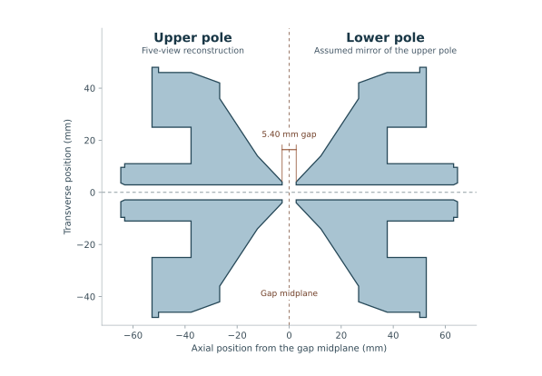
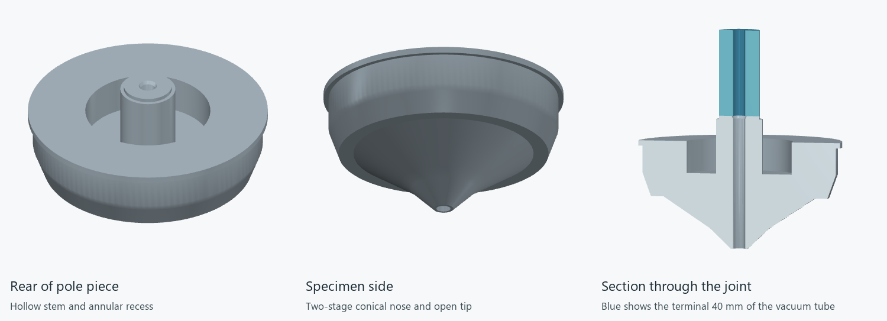
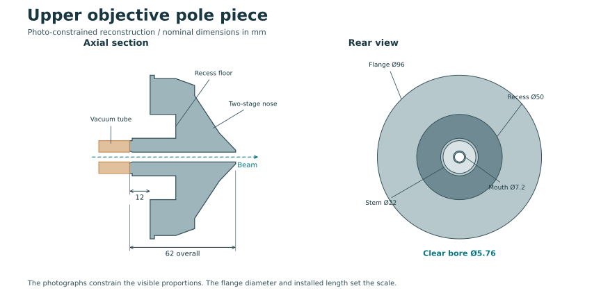
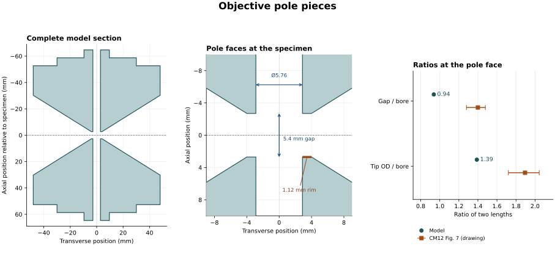

# Objective pole-piece dimensions and profile audit

## Current objective pole pair

All seven column configurations use the same pair. Five photographs constrain the upper pole. The lower pole is assumed to be its complete axial reflection, including the rear well, tubular stem, entrance chamfer and compound nose. The Ø8.00 mm pole faces lie at −2.70 and +2.70 mm about the gap midplane. Both bores open to Ø5.76 mm. [Column configuration](../../configs/instruments/column/C3_ProbeCorrector.toml) · [Section generator](../../src/temsim/pole_geometry.py)

The pair STEP contains two separately selectable pole solids with the origin at the gap midplane and positive Z downstream. After reimport, the reflected upper solid and the lower solid have zero volume difference in both subtraction directions. A Ø5.76 mm cylinder passes through the pair with zero material intersection. The lower pole clears its winding copper by 5.00 mm in every column configuration. [Objective pole pair, STEP](objective-pole-pair.step)

### Upper-pole and tube reference

The upper reconstruction uses the Ø96 mm flange, 62 mm installed length and Ø19.2 mm tube joint as scale anchors. The five photographs provide the relative dimensions.

The separate upper-pole STEP includes the terminal 40 mm of the upstream vacuum tube to show its joint. Both solids passed a Ø5.76 mm coaxial clearance check after reimport. [Upper pole and vacuum tube, STEP](upper-objective-and-tube.step)

| Feature | Nominal geometry | Basis |
|---|---|---|
| Rear face | Ø96 flange, Ø50 annular recess, Ø22 stem, Ø7.2 entrance | In the nearly axial view, edge pairs across the center span approximately 1,308, 689, 297 and 97 pixels. The corresponding modeled diameter ratios are 1, 0.521, 0.229 and 0.075. |
| Tube joint | Ø19.2 end register, 1.5 mm long, with a lead-in from Ø7.2 to Ø5.76 | The incoming tube has a Ø5.76 bore. The coincident end faces overlap from radius 3.6 to 9.6 mm. The internal lead-in is an engineering assumption. |
| Stem and well | Stem projects 12 mm beyond the flange. The well extends another 15 mm into the body. | The side views constrain the projection. The two oblique rear views show a floor between the stem and the recess wall. Its depth is estimated. |
| Body and nose | 2.5 mm flange, Ø92 barrel, 11 mm bevel ending at Ø84, then a radial shoulder to Ø72 | The two side views show the thin rear rim, cylindrical outside and bevel. |
| Specimen-facing end | The two cone sections pass through Ø72, Ø28 and Ø8 at 24, 9.5 and 0 mm behind the face | These are piecewise-linear fits. The central passage is open to the specimen. |

The near-axial image is `d985f322eb2ab14d949bc1faadd7a3e.jpg`. The approximate horizontal readings above use the oriented original at image row 2323. Perspective, near-edge reflections and the lack of a scale limit the precision. The geometry omits the fine rim groove and the internal seal construction.

The native 3D part, STEP, axisymmetric magnetic material grid and EDS interception use the same meridional section. In the default Probe Corrector column, STEP solid checks give 248.81 mm² of annular contact with the tube, 5.00 mm clearance to upper winding copper and 3.80 mm to its nearest cooling plate. A Ø5.76 mm test cylinder crosses the tube joint and the full pole with zero common material volume. The unshifted 32.06° EDS centre ray has 0.311 mm minimum radial clearance at the specimen-side face. Full detector acceptance and off-axis beam transmission require additional inputs.

### Possible magnetic coupling through the tube

The model treats the column tube as a passive vacuum wall by default. A permeable tube end in magnetic contact with the stem can carry axial flux through its annular mating face. The photographs do not identify the alloy, a possible intervening seal or the upstream magnetic path. The Philips CM12 drawing identifies its own vacuum tubes, pole pieces and ferromagnetic core separately. [Philips CM12/STEM, Fig. 7][cm12]

A small-signal axisymmetric FEM comparison used the installed split objective winding, both poles and both yoke halves. A 40 mm terminal segment of the existing tube was included at its modeled ID, OD and contact plane in both cases. The imposed excitation was 1 A·turn in total, the iron regions used a constant relative permeability of 1,000, and the annular contact was ideal. Only the terminal tube's relative permeability changed. The calculation excluded the other lens circuits, hysteresis, saturation and contact-film reluctance. [Reproduce the comparison](../../scripts/compare_objective_tube_permeability.py)

| Tube relative permeability | Axial flux through the mating annulus | Axial field at specimen center |
|---:|---:|---:|
| 1 | 2.21 nWb | 5.40 µT |
| 1,000 | 24.74 nWb | 6.99 µT |

The table uses the mirrored poles and the finest mesh (196 radial by 542 axial nodes). The contact flux equals the difference in $2\pi r A_\phi$ between the outer and inner mating radii. Four mesh/domain pairs gave a contact flux ratio of 10.6–11.2 at 1 A·turn. Enlarging the domain at the same local mesh spacing changed the specimen field by 6.4–6.6%. The final local refinement changed the high-permeability contact flux by 1.5%. In the earlier run with a single-taper lower pole, the corresponding fluxes were 2.22 and 24.81 nWb and the specimen fields were 5.22 and 6.80 µT. Predicting the operating field requires the measured tube material, interface and excitation.

## Earlier single-taper pair

Before the photographs of the upper pole were available, the simulator used a mirrored pair. The geometry, figure and validation counts below document that earlier version. The 5.4 mm model gap matches the S-TWIN specifications for Themis Z and Spectra Ultra. The product sheets leave the bore, tip diameter, nose contour and mounting dimensions open. [Themis Z, p. 3][z] · [Spectra Ultra, p. 4][ultra] · [Philips CM12/STEM, Fig. 7, p. 279][cm12]

### Dimensions of the earlier pair

All lengths below are millimetres. The sample and objective centers coincide in the catalog configurations. The upper pole has negative axial coordinates relative to that center, the lower pole positive. Diameters are measured across the beam axis. The table describes one pole wherever the two are identical. [Example column manifest](../../configs/instruments/column/C3_ProbeCorrector.toml) · [Native section generator](../../src/temsim/cad_round_lenses.py)

| Physical feature | Native CAD dimension | How to read it |
|---|---:|---|
| Gap between opposed flat faces, *g* | 5.4 | Faces at −2.7 and +2.7. The virtual field references sit at ±1.35. |
| Beam bore, *b* | Ø5.76 upper and lower | Radius 2.88 through the full 62 mm length of each pole, including the rear connector. |
| Flat face outer diameter, *D* | Ø8.00 upper and lower | The radial width of iron at each face is (8.00 − 5.76)/2 = **1.12**. |
| Conical nose | 27.5584 axial, Ø8 → Ø96 | One straight slope, 57.940° to the beam axis and 32.060° to the specimen plane. The cone starts at the flat face. The model has no cylindrical tip land, edge fillet or bore flare. |
| Cylindrical body after the nose | Ø96 × 22.4416 axial | Reaches from 30.2584 to 52.7 from the specimen center. The separate return yoke and housing have outer diameters of 170 and 180. |
| Rear mounting shank | 12.0 total | The first 6.0 after the body is Ø60.0. The last 6.0 is a reduced Ø19.2 connector. |
| One complete pole | 62.0 axial | 27.5584 + 22.4416 + 6.0 + 6.0. Its back face is 64.7 from the specimen center. |

The actual section gives *g/b* = 0.9375, *D/b* = 1.3889 and body OD / face OD = 12. The model history explains the unusually specific nose length. The design retained the Ø96 body and Ø5.76 bore and cleared a 32.06° EDS reference ray. The reconstructed nose leaves 0.31085 mm of **radial** clearance at the face and 0.31091 mm at the shoulder. At this gap the ray crosses the pole-face plane at radius 4.31085 mm. An 8.622 mm face OD would just graze it. Clearance across a detector's full active area also depends on its finite extent, the collimator, specimen holder, azimuthal cutouts and tilt. [Project EDS geometry study, items 4–6](../TEM_PROJECTOR_AND_EDS_GEOMETRY_RESEARCH_2026-08-30.md)

## What the Philips drawing resolves

Gross and colleagues label the pole pieces **PS** and the surrounding ferromagnetic core **FC** in Fig. 7. The drawing shows the specimen between the two noses, a flat annular face on each side, and a change of outer slope behind the first taper. The upper assembly also accommodates the mini-condenser. The authors describe a radial passage in the upper pole for the secondary-electron detector on p. 281. A symmetric immersion objective can therefore have different upper and lower hardware details. [Fig. 7, p. 279][cm12] · [Fig. 8d, p. 280][cm8] · [Detector description and Table I, p. 281][cm-table]

| Dimensionless comparison | Earlier mirrored model | CM12 Twin, estimated from Fig. 7 |
|---|---:|---:|
| Face OD / bore diameter | 1.389 | ≈1.89 (1.72–2.04) |
| Pole gap / bore diameter | 0.938 | ≈1.40 (1.28–1.48) |
| Radial iron width at one face / bore diameter | 0.194 | ≈0.45 (0.36–0.52) |
| First outer taper angle to the beam axis | 57.94° | Approximately 56–60°, followed by a different slope |

**How the drawing was read.** PDF page 7 was rendered with its aspect ratio preserved and its long side set to 3700 pixels. In a crop starting at (1670, 1430), 310 × 540 pixels, the black bore walls were about 47–48 pixels apart. The face OD was about 90 pixels, and the gap about 66–67 pixels. The ranges above allow 46–50, 86–94 and 64–68 pixels respectively for picking the ink edges. On the upper left flank, about 37 pixels of radial run correspond to 23 pixels of axial rise. The blue flux lines and the black specimen symbol were excluded. These ranges express drawing-readout sensitivity. The paper supplies neither a dimensional calibration for this view nor manufacturing tolerances. Table I gives **focal lengths** of 2.7 mm (Twin) and 1.7 mm (Super-Twin), with maximum tilt of ±60° and ±15° respectively. Its focal lengths cannot calibrate the drawing. [Fig. 7][cm12] · [Table I][cm-table]

## What differs between documented pole-piece types

| Instrument and objective | Reported gap | Other geometry or access evidence |
|---|---:|---|
| Themis Z and Spectra Ultra, S-TWIN | 5.4 mm | Each manufacturer sheet specifies a symmetric wide-gap objective. The sheets give no face OD, bore ID or shank drawing. [Themis Z][z] · [Spectra Ultra][ultra] |
| Themis S, symmetric objective | 5.6 mm | 0.2 mm wider than the model. [Manufacturer sheet, p. 2][s] |
| Metrios AX, X-TWIN | 5.4 mm | The manufacturer explicitly calls this X-TWIN symmetric. The 5.4 mm gap is shared with the two S-TWIN examples above. [Manufacturer sheet, p. 3][metrios] |
| Tecnai Osiris, analytical objective, Antwerp installation | 6 mm | The installed instrument uses four Super-X detector quadrants. [Antwerp EMAT instrument description][osiris] |
| Titan 60–300, C-TWIN, holography installation | 11 mm | The experimental team identifies the installed pole and its gap. The reported Lorentz measurements were made with the main objective switched off. [Materials and methods, p. 2][ctwin] |
| York environmental TEM, UHR class | 2.2–2.5 mm | The authors' class range. Their standard hot stage does not fit. [Boyes and Gai, Table 1][york] |
| York environmental TEM, Midi class | 4.3–5.4 mm | The standard hot stage fits. The paper separately identifies about 4.3 mm for the York HRP installation. [Boyes and Gai, Table 1 and text][york] |

**Four lenses on one platform.** For the Tecnai G² F20, FEI gives these holder limits without giving numerical pole gaps in its comparison table. Tilt depends on the complete holder and pole geometry and does not determine a unique gap. In a separate Tecnai X-Twin design paper, the designers describe adjusting both the bore and the gap and adding a beryllium shield on the lower pole. Its 25° EDX elevation describes the detector. [FEI F20 product data, p. 2][f20] · [X-Twin design, Fig. 1][xtwin]

| F20 holder specification | TWIN | S-TWIN | X-TWIN | U-TWIN |
|---|---:|---:|---:|---:|
| Maximum tilt with double-tilt holder | ±70° | ±40° | ±30° | ±20° |
| Maximum tilt with tomography holder | ±80° | ±80° | ±80° | Listed as n/a |

**Documented bore and face proportions.** Tsuno and Harada define the upper/lower bore diameters and face outer diameters separately in Fig. 2. Their equal-bore side-entry study uses a 5.0 mm gap and sets both face ODs to **twice** the bore diameter. The resulting radial face width is 0.5 bore diameters, compared with 0.194 in the project. They also report a selected 3 mm lower bore in their instrument. The printed relation for the unequal-bore series repeats a subscript, so the other three diameters cannot be reconstructed reliably from that line. For their top-entry design the upper bore must exceed 7 mm to admit the holder, and the selected specimen position is 1.65 mm above the lower face. These are separate designs. [Tsuno and Harada, pp. 473–475, Figs. 1, 2 and 5][jeol-bore]

**Same gap, different nose.** JEOL's GRAND ARM FHP and GRAND ARM2 FHP2 have the same gap width. Its Fig. 2 compares different outer contours to accommodate the larger X-ray detector. The WGP uses a wider gap for detector and holder access. The manufacturer describes the narrower FHP section as thick enough to limit magnetic saturation. No absolute FHP/FHP2 gap is specified there. This is direct evidence that a matching gap alone cannot determine the iron contour. [JEOL News, vol. 55, Fig. 2, printed p. 43][jeol-fhp]

## Verification of the earlier mirrored pair

The audit resolved each `AssemblyCatalog.columns` entry with `read_document`, generated both poles with `round_lens_solids` and registered them to the sample center. All fourteen sections have identical vertices after upper/lower reflection. For each pole the native CAD polygon and the axisymmetric magnetostatic material mask agreed on a 433 × 281 offset axial/radial grid spanning the tip, bore, body, shank and surrounding vacuum. That is 1,703,422 matching point classifications. This is a geometry check. Magnetization, aberrations, probe size, full detector acceptance and manufacturing dimensions require independent evidence. [Catalog](../../src/temsim/assembly_catalog.py) · [CAD](../../src/temsim/cad_round_lenses.py) · [Magnetostatic material mask](../../src/temsim/physics/axisymmetric_magnetostatics.py)

[cm12]: https://pearl-hifi.com/06_Lit_Archive/02_PEARL_Arch/Vol_16/Sec_53/Philips_Tech_Review/PTechReview-43-1986_87-273.pdf#page=7
[cm8]: https://pearl-hifi.com/06_Lit_Archive/02_PEARL_Arch/Vol_16/Sec_53/Philips_Tech_Review/PTechReview-43-1986_87-273.pdf#page=8
[cm-table]: https://pearl-hifi.com/06_Lit_Archive/02_PEARL_Arch/Vol_16/Sec_53/Philips_Tech_Review/PTechReview-43-1986_87-273.pdf#page=9
[z]: https://assets.thermofisher.com/TFS-Assets/MSD/Datasheets/Themis-Z-Datasheet.pdf#page=3
[ultra]: https://documents.thermofisher.com/TFS-Assets/MSD/Datasheets/spectra-ultra-ds0361-materials-science-datasheet.pdf#page=4
[s]: https://documents.thermofisher.com/TFS-Assets/MSD/Datasheets/Themis-S-TEM-Datasheet.pdf#page=2
[metrios]: https://assets.thermofisher.com/TFS-Assets/MSD/Datasheets/metrios-ax-datasheet-DS0316.pdf#page=3
[osiris]: https://www.uantwerpen.be/en/research-groups/emat/research/instrumentation/microscopes/tem-stem/
[ctwin]: https://doi.org/10.1016/j.ultramic.2020.113098
[york]: https://comptes-rendus.academie-sciences.fr/physique/item/10.1016/j.crhy.2014.01.002.pdf#page=5
[f20]: https://cdn.auckland.ac.nz/assets/rcsms/our-facilities/documents/2007_07_TecnaiF2_20_ds.pdf#page=2
[xtwin]: https://doi.org/10.1017/S1431927605505348
[jeol-bore]: https://www.jstage.jst.go.jp/article/matertrans1960/24/6/24_6_473/_pdf/-char/en#page=2
[jeol-fhp]: https://www.jeolusa.com/Portals/2/jeolnews/JEOL%20News%20July%202020%20Vol.%2055%20No.%201.pdf
