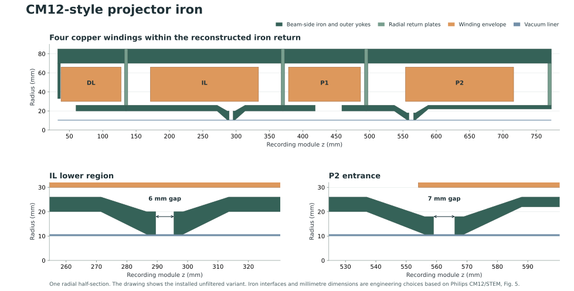
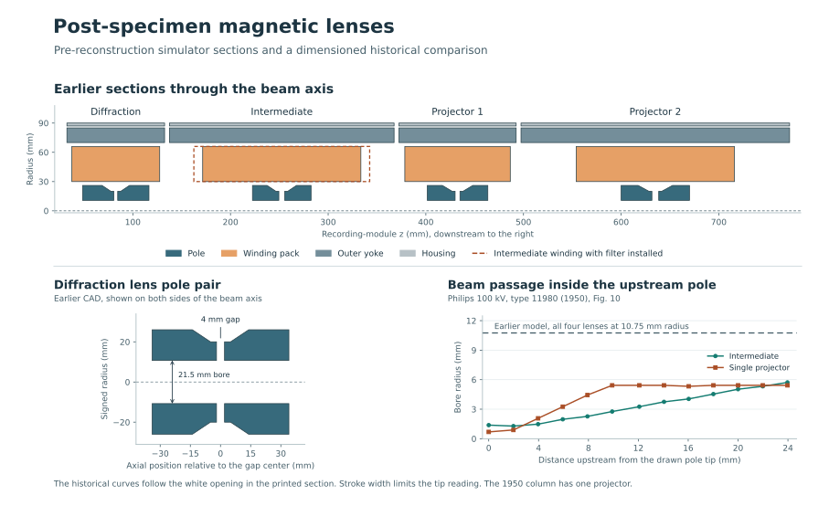

# Diffraction, intermediate and projector lens geometry

The Philips CM12/STEM has the same four named post-specimen lenses as this simulator. Its column section and the CM100/120 service instructions give a better starting point for the mechanical assembly than four copies of an isolated lens. A dimensioned Philips 100 kV section also shows how differently the iron can be machined around the beam at successive stages. The reviewed material leaves the production dimensions of the four Titan/Spectra lenses undetermined. [CM12/STEM, Fig. 5, p. 278](https://pearl-hifi.com/06_Lit_Archive/02_PEARL_Arch/Vol_16/Sec_53/Philips_Tech_Review/PTechReview-43-1986_87-273.pdf#page=6) · [CM100/120 Mechanics, §5.24](https://www.scribd.com/document/516569721/CM-100-120-Mechanics) · [Philips type 11980, Fig. 10, p. 41](https://pearl-hifi.com/06_Lit_Archive/02_PEARL_Arch/Vol_16/Sec_53/Philips_Tech_Review/PTechReview-12-1950-033.pdf#page=9)

## Installed CM12-style reconstruction

Fig. 5 shows the four windings and the outlines of the long inner wall, openings and constrictions. The authors call it a schematic cross-section. The short lines drawn on the axis cannot identify every mechanical joint, alloy, magnetic break or pole tip. The model interprets these outlines as a continuous DL-to-IL sleeve, opposed iron faces low in IL, a wide opening within P1, and a second pair of opposed faces near the P2 entrance. Fig. 7 labels pole shoes and flux conductors on the objective. It does not give a parts list for the projector. [Gross, Mescher and Tiemeijer, Fig. 5, p. 278 and Fig. 7, p. 279](https://pearl-hifi.com/06_Lit_Archive/02_PEARL_Arch/Vol_16/Sec_53/Philips_Tech_Review/PTechReview-43-1986_87-273.pdf#page=6)

Distances below use the recording-module entrance as the axial datum. All dimensions are engineering choices fitted to the existing housings and beam tube. They apply to both recording options.

| Stage | Winding centre *z* (mm) | Reconstructed beam-side iron |
| --- | ---: | --- |
| DL | 82.5 | Wide entrance return lip at 32.5–36.5 mm. A sleeve starts at 60 mm and joins IL at 135 mm. Its straight section has a 40 mm iron bore. |
| IL | 252.5 | The upstream sleeve ends at 289.5 mm. A 6 mm gap separates it from the lower pole starting at 295.5 mm. The iron bore narrows to 21.5 mm at both faces. The lower section feeds the upper P1 sleeve. |
| P1 | 432.5 | Iron ends at 418.5 mm and resumes at 458.5 mm, leaving a 40 mm opening. The lower sleeve joins the P2 entrance at 495 mm. |
| P2 | 635 | A 7 mm gap extends from 559 to 566 mm. The bore at both faces is 21.5 mm. It opens to 44 mm in the exit section leading to the downstream return plate. |

The model contains eight beam-side iron pieces, four cylindrical outer yokes and four radial return plates. Three 5 mm plates occupy the interfaces between successive yokes. The fourth joins the exit sleeve to the P2 yoke. The shared outer return and its joints are engineering assumptions. The four coils have separate current owners within one coupled magnetic circuit. Both modules retain their original copper, optical reference planes and drive settings. IL uses 648 turns over 162 mm without the filter and 720 over 180 mm with the filter. The beam tube retains a 20 mm clear diameter and a 0.75 mm wall. The DL and P1 legacy optical reference lengths are independent of their mechanical openings. [Unfiltered module](../../configs/instruments/project_and_recording_system/NoEnergyFilter.toml) · [Filtered module and its projector subassembly](../../configs/subassemblies/projector_stack.toml)

The native CAD and axisymmetric FEM read the same radial contours. Each IL/P2 face has a 3 mm land. Both the inner bore and outer contour taper towards that land. In the geometry-dependent solver, driving one coil magnetizes the shared circuit. The ideal copper model uses vacuum permeability and the Gaussian model uses its saved effective field law. Measurements of axial field at known currents, a material curve and image/diffraction calibration would be needed to qualify the reconstruction against an instrument. [Magnetic circuit models](../MAGNETIC_CIRCUIT_MODELS.md)

### Fixed-current material check

Each row drives a single channel at 100 A·turn. These are maximum absolute axial fields over the 32.5–772.5 mm span, sampled every 0.5 mm using the installed linear FEM provider. The vacuum control and iron case use identical winding currents, material interfaces, boundaries and mesh. The iron case assigns relative permeability 100 to the modeled magnetic bodies. The permeability and excitation are diagnostic inputs.

| Driven winding | Vacuum peak, unfiltered (mT) | Iron peak, unfiltered (mT) | Iron peak, filtered (mT) | Peak *z* with iron (mm) |
| --- | ---: | ---: | ---: | ---: |
| DL | 0.941 | 2.175 | 2.175 | 52.5 |
| IL | 0.643 | 3.039 | 2.997 | 294.0 |
| P1 | 0.849 | 2.072 | 2.072 | 436.5 |
| P2 | 0.643 | 2.405 | 2.405 | 560.5 |

The finest run used 80 by 240 base nodes, with material boundaries adding nodes to give 98 radial by 287 axial positions. Relative to the 48 by 144 base mesh the iron peak changed by up to 2.5%. These figures describe the finite mesh and linear material used here. The Gaussian and ideal copper providers separately reproduced their pre-reconstruction axial fields at all 161 comparison positions for each winding in each module. The applied field model determines whether iron changes the result.

A further control changed only the four radial return plates from relative permeability 100 to 1. Every other material, winding, current and mesh point stayed fixed. Relative to the full iron case, the axial field curves changed by 19.1% (DL), 26.2% (unfiltered IL), 25.3% (P1) and 21.2% (P2) in sampled L2 norm. The corresponding filtered IL change was 27.7%. This control isolates the contribution of the new return plates.

## Geometry before the reconstruction

This baseline records the earlier four independent pole pairs. The sections and table in this subsection refer to those historical inputs. The axial origin is the entrance to the recording module and positive *z* points downstream. Distances are millimetres. [Archived unfiltered geometry](../development/wire_area_20261115/validation/installed/configs/instruments/project_and_recording_system/NoEnergyFilter.toml) · [Archived filtered projector stack](../development/wire_area_20261115/validation/installed/configs/subassemblies/projector_stack.toml)

| Lens | Gap center *z* | Housing length | Pole gap | Length of one pole | Outer nose length including land | Outer taper angle to axis | Winding length, unfiltered / filtered |
| --- | ---: | ---: | ---: | ---: | ---: | ---: | ---: |
| Diffraction (DL) | 82.5 | 100 | 4 | 32 | 12 | 33.7° | 90 / 90 |
| Intermediate (IL) | 252.5 | 230 | 6 | 27 | 12 | 33.7° | 162 / 180 |
| Projector 1 (P1) | 432.5 | 120 | 5 | 28.5 | 13 | 31.0° | 108 / 108 |
| Projector 2 (P2) | 635 | 275 | 7 | 31.5 | 14 | 28.6° | 162 / 162 |

All four housings have a 180 mm outer diameter. Each lens has mirrored upper and lower poles, with a straight 21.5 mm iron bore and a separately declared 20 mm clear beam diameter. The outer pole profile goes from 52 to 40 mm diameter, with a 3 mm cylindrical land at the face. The taper angles in the table follow from the 6 mm change in radius divided by the axial taper run, inside an arctangent. The saved 63° angle and 2–4 mm root fillet range are reference metadata. The exported sections have sharp corners. IL also changes from 648 to 720 turns when the filtered recording module is installed. These are two installed winding definitions. [Pole contour implementation and history](cad-round-lenses.md) · [Unfiltered IL](../../configs/instruments/project_and_recording_system/NoEnergyFilter.toml) · [Filtered IL](../../configs/subassemblies/projector_stack.toml)

The magnetic return is the clearest structural omission. The pole root reaches radius 26 mm, the copper occupies radii 30–66 mm, and the modeled soft-magnetic outer yoke starts at radius 70 mm. None of the four round-lens assemblies has a modeled iron plate or carrier connecting its pole root to its outer yoke. The 44 mm radial difference spans copper and clearances. The axial working gaps are the 4–7 mm entries above. Native CAD assigns the pole solid the material label `Unspecified`; the magnetostatic code recognizes its pole role. A measured alloy grade or magnetization curve would be a separate input. [Native material CAD](../../src/temsim/cad_catalog.py) · [Magnetostatic material classification](../../src/temsim/part_materials.py)

## What the four-stage Philips instruments establish

Gross, Mescher and Tiemeijer identify DL, IL, P1 and P2 individually in their CM12/STEM section. The DL and IL winding packs appear similar in axial height. P1 and P2 likewise appear similar to one another, and both are shorter than the first pair. In the simulator IL is 1.8 or 2 times as long as DL and the P2 winding is 1.5 times as long as P1. The CM12 illustration supports a comparison of proportions. It supplies no axial scale for those four packs. Its 200 µm dimension belongs to the vacuum partition diaphragm. [Philips CM12/STEM, Fig. 5 and accompanying text](https://pearl-hifi.com/06_Lit_Archive/02_PEARL_Arch/Vol_16/Sec_53/Philips_Tech_Review/PTechReview-43-1986_87-273.pdf#page=6)

At DL the drawing does not resolve a separate pair of pole tips. At the IL/P1 interface the dark material around the axis appears continuous. At P2 the passage opens towards the projection chamber. All three details can be seen in the published figure. Its callouts identify complete lenses and the partition diaphragm. They leave the iron parting lines and magnetic connections ambiguous. A pole-free DL, a common IL/P1 pole and a magnetically independent P2 are hypotheses to check against a CM12 parts section. The simulator C1/C2 comparison is specifically a common mechanical cartridge with separately owned poles. [Gross et al., November 1987, complete issue, Fig. 5](https://www.worldradiohistory.com/Archive-Company-Publications/Philips-Technical-Review/80s/Philips-Technical-Review-1987-11.pdf#page=10) · [C1/C2 carrier and separate poles](cad-round-lenses.md)

The CM100/120 service handbook describes two removable lens assemblies and identifies the following components in the procedure keyed to Fig. 810. Numbers in the table are service part callouts. [CM100/120 Mechanics, 50129 060427, §5.24, pp. 5-49 through 5-52](https://www.scribd.com/document/516569721/CM-100-120-Mechanics)

| Stage | Mechanical evidence from CM100/120 | Information still needed for reconstruction |
| --- | --- | --- |
| DL | Coil 18 and pole plate 16 are removed from the D/I unit. Housing 20 also contains the intermediate coil. | Bore and face profile, plate thickness, and contact between plate, carrier and outer return. |
| IL | Coil 25 mounts to lower plate 26. Pole-piece assembly 21 is retained inside the D/I unit and remains assembled during service. | Section through assembly 21 showing individual iron pieces, nonmagnetic interfaces and the working gaps. |
| P1 | Coil 57 sits on carrier 56. The carrier separates from carrier 59 during dismantling of the projector unit. | Shape of carrier 56 around the coil and the radial and axial interfaces at its two ends. |
| P2 | Coil 64 attaches to pole piece 59. The assembly is centered on carrier 56 and closed with part 67. The projector pair lifts out together. | Exit bore, lower return, and clearances through to the projection chamber. |

These instructions establish how the units fit together. Determining whether two coils share a continuous piece of magnetic iron, or how many working gaps belong to a particular circuit, requires a material section through the carriers. Optical controls can remain separately excited in a common mechanical assembly. [CM100/120 service procedure](https://www.scribd.com/document/516569721/CM-100-120-Mechanics) · [Simulator support for circuit and coil ownership](../MAGNETIC_CIRCUIT_MODELS.md)

## Dimensions and pole shapes from identified instruments

**Philips type 11980, 100 kV, 1950.** The authors describe three lower windings on a common iron cylinder with magnetically insulating rings between stages. The poles and spacers fit inside the cylinder. Figure 10 shows a comparatively wide DL passage. The inner walls of IL and the single final projector narrow towards the working gap and open out away from it. Changing only the exterior nose on a straight-bored sleeve cannot reproduce either inner profile. The final lens in this instrument supplies one historical projector example. [A. C. van Dorsten, H. Nieuwdorp and A. Verhoeff, Fig. 10 and construction description](https://pearl-hifi.com/06_Lit_Archive/02_PEARL_Arch/Vol_16/Sec_53/Philips_Tech_Review/PTechReview-12-1950-033.pdf#page=9)

| Winding dimension read from Fig. 10 | Diffraction | Intermediate | Single projector |
| --- | ---: | ---: | ---: |
| Axial height of crosshatched winding pack | ≈21 mm | ≈40 mm | ≈43 mm |
| Outside diameter across the winding pack | ≈122 mm | ≈122 mm | ≈122 mm |

For reproduction, render PDF page 9 with `pdftoppm -f 9 -l 9 -scale-to 4290 -x 120 -y 1090 -W 1230 -H 2450 -png -singlefile article.pdf figure10`. In this crop the printed 380 mm vertical span covers about 1,919 pixels, and the 132 mm horizontal span covers about 669 pixels. The two scales agree within 0.4%. Left and right winding edges were read separately. Pack dimensions are rounded to whole millimetres. These are readings from a simplified drawing with finite line thickness. The authors give no manufacturing tolerances. [Dimensioned original, p. 41](https://pearl-hifi.com/06_Lit_Archive/02_PEARL_Arch/Vol_16/Sec_53/Philips_Tech_Review/PTechReview-12-1950-033.pdf#page=9)

For the two historical curves above, the upper lip reference rows are 1510 (IL) and 1872 (projector), measured down from the top of the same crop. At 2 mm intervals upstream, the first dark pixel on either side of the white opening defines the drawn width (8-bit grayscale threshold 127). Half that width times the horizontal scale gives the plotted radius. The curves resolve the flare and straight portions. Near the narrowest passage, line thickness is a substantial fraction of the opening. [Original sections of L4 and L5](https://pearl-hifi.com/06_Lit_Archive/02_PEARL_Arch/Vol_16/Sec_53/Philips_Tech_Review/PTechReview-12-1950-033.pdf#page=9)

| Additional primary evidence | Dimension and design | Scope |
| --- | --- | --- |
| Delft experimental microscope, 150 kV, J. B. le Poole | The author reports a 3.5 mm projector bore and a roughly 1 mm useful beam field at the lens. | Directly stated bore on a particular built instrument. [Philips Technical Review 9, p. 39](https://www.worldradiohistory.com/Archive-Company-Publications/Philips-Technical-Review/40s/Philips-Technical-Review-1947.pdf) |
| JEOL projector design, K. Tsuno | Fig. 1 shows flared outer poles, a middle pole and an outer magnetic return. The reference case in Fig. 2 has three 3 mm bores, two 2.25 mm gaps and a 1 or 2 mm central pole. | One compound projector with opposing gap fields. Assigning one gap to P1 and the other to P2 would require separate evidence. [US4412132A, Figs. 1–2 and cols. 1–2](https://patentimages.storage.googleapis.com/00/96/a2/ff8b3546496db6/US4412132.pdf#page=2) |
| Osaka 3 MeV ultrafast TEM, J. Yang | The intermediate and projector each use two symmetric, separable poles, with a 20.8 mm gap and gap-to-bore ratio of about 1.6 (implied bore ≈13 mm). | An implemented example of symmetric pairs at a substantially different energy and optical scale. [Instrument description, §2.2.3](https://www.intechopen.com/chapters/63863) |

## Implications for a reconstruction

1. **Identify the iron return and the assembly interfaces before setting new outer diameters.** The best reference here for a conventional four-stage Philips column is the D/I unit and P1/P2 unit. For each, a dimensioned longitudinal section or a measured disassembled carrier would settle the pole seats, return plates, coil pockets and insulating breaks. A shared housing alone leaves the magnetic connectivity open. [CM100/120, lower lens section](https://www.scribd.com/document/516569721/CM-100-120-Mechanics)
2. **Specify the inner and outer contour of each upper and lower pole separately.** The most consequential missing measurements are the minimum bore, entrance and exit diameters, taper lengths, lip thickness, axial gap and pole-to-pole spacing between successive lenses. Register those measurements to a common mechanical datum. Keep the beam tube, limiting diaphragms and pole metal as distinct surfaces. The 1950 sections provide traceable example profiles for a reference geometry. [Philips type 11980, Fig. 10](https://pearl-hifi.com/06_Lit_Archive/02_PEARL_Arch/Vol_16/Sec_53/Philips_Tech_Review/PTechReview-12-1950-033.pdf#page=9)
3. **Qualify the optics independently of the CAD.** A geometry-dependent magnetic solve needs the material interfaces, excitation and magnetic material data. Useful comparison measurements are axial field versus position at known current and beam energy, image magnification and rotation, diffraction camera length and transmitted angular field. The Titan training diagram identifies conjugate planes. [Simulator magnetic models](../MAGNETIC_CIRCUIT_MODELS.md) · [FEI Titan training material, module 3, Fig. 2](https://emfacility.science.oregonstate.edu/sites/emfacility.science.oregonstate.edu/files/2025-09/Titan%20training%20manual_0.pdf)
