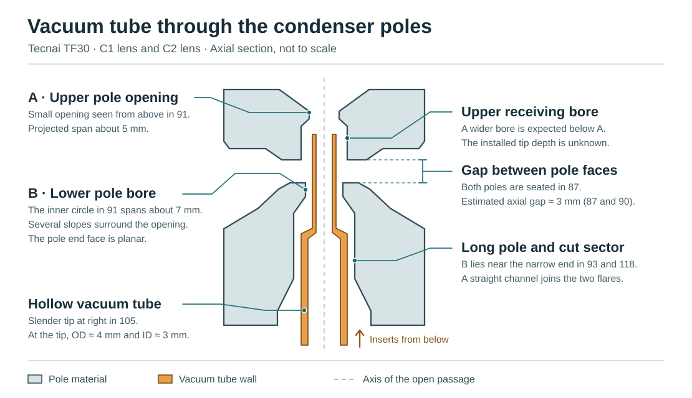

# Tecnai TF30 cutaway measurements and column comparison

The two photo sets show a Tecnai TF30 with a C1 lens and a C2 lens. The owner confirms that this instrument had neither a C3 lens nor a probe corrector. Its shared condenser pole cartridge is about **154–159 mm long** in three views. The removed sector reveals a **straight internal channel with a flare at each end**. The straight section spans about **63 mm** along the ruler in frame 118. Both simulator columns compared below use a **300 mm cartridge** and **straight Ø19.2 mm bores** in the two magnetic poles. The true half-angles of the TF30 flares remain undetermined.

The two-condenser simulator configuration is the closest match in lens count. The default probe-corrected configuration gives the target geometry for comparison. Both are engineering reconstructions. Dimensions below are in millimetres unless stated otherwise. A range across photographs describes the spread of projected readings. [Two-condenser configuration](../../configs/instruments/column/C2.toml) · [Default probe-corrected configuration](../../configs/instruments/column/C3_ProbeCorrector.toml)

## Shared C1 lens and C2 lens pole cartridge

The short cup and long body in frame 93 are the two separable members of the shared C1 lens and C2 lens pole cartridge. Frame 91 shows both parts from above. The long sector in frames 116–118 fits the cutout in the long body and reveals the shape of its bore. The owner confirms that the parts in frame 87 are fully seated. A gap remains between the magnetic poles, and the installed vacuum tube spans that gap along the axis. Frame 93 shows the two parts apart on the bench.

| Feature and frames | TF30 photo reading | Corresponding simulator geometry |
| --- | --- | --- |
| Assembled outside length, 87, 89, 90 | 159, 157, 154 | 300 from end to end |
| End face, 88 | Outer rim Ø44. Visible conical entrance spans about 26 at a different depth. | Carrier Ø90.75 outside and Ø60 inside. Each pole shoulder is Ø60. The photo only identifies the two visible rims. |
| Short cup, 93 | 46.5 rim to rim. Side port spans 7.2 axially. Two segments of the visible inner-wall profile project to 8.5 and 4.4 along the ruler. | C1 lens pole length 50. C2 lens pole length 60. The CAD carrier has no radial service opening. |
| Long body, 93 | From the nose, about 106 to the internal exit lip and 121 to the furthest exterior rim. Those edges lie at different depths. | The cartridge, individual magnetic poles and vacuum tube have separate end faces. |
| Axial gap between the seated poles, 87 and 90 | **About 3** across the dark band near the bore. Each view gives the same whole-millimetre estimate using its own tape scale. | 20 between the condenser pole faces in both simulator columns. The objective specimen gap is a separate 5.40. |

The outer face spans in frame 91 are about 47 and 64 at the respective heights of the loose poles above the table. The surviving span in 94 is about 78. The outer rims, cone mouths and bores each have distinct edges. [Earlier condenser cartridge evidence and CAD sections](condenser-pole-piece-tails.md)

### Tube entry, pole bores and installed spacing

In the annotated view of frame 91, **A** marks the recessed part at the top of the photograph and **B** marks the projecting part below it. In assembly, the slender end on the right of frame 105 enters from below, passes through B's inner circle and spans the inter-pole gap. The owner expects the tip to extend into the underside of the upper pole. The shape of the receiving bore is inferred from this fit. The insertion depth is unknown. [Axial section of the tube and poles](tecnai-tf30-tube-pole-section.svg)

| Frame 91 feature | Rounded projected diameter | Use in the assembly |
| --- | --- | --- |
| A · Small opening seen from above on the upper pole | **About 5** across the shadowed opening in three neighboring traces. The entrance lip spans about 29. | Keep a small opening on the top side. A larger bore below it is expected to admit the tube tip. Its diameter and depth have no direct reading here. |
| B · Inner circle in the lower pole | **About 7** between the inner edges. The highlight extends beyond the inner circle. The dark sloping region spans about 20 at its outer boundary. | The tube passes through the inner circle. This is the bore near the narrow end of the long body in 93 and its removed sector in 118. Several slopes surround the opening, and the terminal face is planar. |

At any axial station where the tube enters a pole, its **local outside diameter** sets a lower bound on the bore. For a concentric fit with clearance $c$ per side, $D_{\rm bore}(z)=D_{\rm tube,OD}(z)+2c(z)$. Frames 102–103 put the slender tip at about **Ø4 outside** and **Ø3 inside**. The inner diameter sets the free passage through the tip. Frame 86 places the first enlargement about 33 from the end. The clearance at B depends on which tube section reaches that plane. The upper receiving bore has its own clearance below A.

The **axial gap** is the separation of the opposing pole faces with the cartridge seated. In frame 87 the dark interval near the bore spans about 27 pixels along the axis, to the left of the bright far-wall reflections visible through the cutout. The corresponding interval spans about 21 pixels in the opposite-side view in 90. Local tape graduations in each photograph give a rounded estimate of **3 mm**. Shadow boundaries and the offset between ruler and pole faces limit its accuracy. The hollow tube crosses this gap when installed. Its final stop and the design reason for this arrangement remain unknown.

### Simplified simulation section

The owner confirmed the assembly shown in the schematic. Use an estimated **3 mm axial gap** for the simplified TF30 geometry. Its four diameter estimates are also rounded to the nearest millimetre. Represent the long member with its planar terminal face, narrow end, straight channel and flared transitions. Carry the hollow stepped tube through B and the gap into the expected receiving bore below A. Set each overlapping bore from the local tube OD and a stated clearance. The axial position of the tube step, insertion depth and chosen flare slopes are model assumptions. Both simulator columns listed for comparison use a nominal 20 mm condenser gap.

### Inner taper with independent axial and transverse scales

In frame 118, the ruler runs along the part. The five consecutive axial readings start at the narrow end of the extracted sector. The owner places the 91-B inner circle near this end. Its exact axial position within that region is unresolved. A–F in the table label axial stations in 118 only. In frame 117, a transverse ruler provides a separate scale for the width between the two edges of the exposed groove. For example, 20 mm occupies 224 horizontal pixels between the 170 and 190 mm marks in 117, and 205 vertical pixels between the 140 and 160 mm marks in 118. Each reading uses the local graduations and direction in its own view.

| Axial detail | Stations in frame 118 | Apparent axial length | Exposed width from frame 117 |
| --- | --- | ---: | --- |
| Narrow end land | A–B | 8.1 | About 1.4 at the narrow land |
| Short inner flare | B–C | 4.8 | Widens to about 4.2 |
| Straight internal channel | C–D | 62.9 | About 4.2 and 4.3 near its two ends |
| Long inner flare | D–E | 17.6 | Widens from about 4.3 to 11.1 |
| Wide end land | E–F | 6.4 | About 11.1 across the groove. The sector material spans 16.0 at this end. |
| End to end | A–F | 99.7 | |

The apparent half-angle of the **chord opening** follows from $\arctan(|\Delta w|/(2\Delta z))$, where $w$ is the exposed groove width. The short flare gives **about 16°** from widths 1.35 and 4.16 over 4.78 axially. The long flare gives **about 11°** from widths 4.31 and 11.12 over 17.58. The narrow-end chord therefore widens faster per millimetre of apparent axial length.

For the **physical cone half-angle to the axis**, the same formula requires complete bore diameters at those axial stations. Even in a normal orthographic view of a radial sector with included angle $\phi$, the chord is only $w=D\sin(\phi/2)$. A tilted cut face also changes the apparent transverse and axial lengths differently. Independent diameters at both flare ends and their axial separation, or a calibrated meridional section through the axis, would resolve the physical angle. A ruler in only one direction cannot correct both directions of an oblique image.

Frame 116 illustrates the effect of pose. The long flare edge makes about **18° in the image** to the neighboring straight wall. The **outside** nose silhouettes of the remaining body in 93 and the removed sector in 118 give about **63° and 29° in their respective images**. They follow different exposed edges. Each observation retains its own reference line in the measurement record. The simulator's **outside** shoulders taper from Ø60 to Ø40 over 19.0 for the C1 lens and 22.8 for the C2 lens, giving nominal exterior half-angles of **27.8° and 23.7°**. The corresponding CAD inner half-angle is **0°** along each straight bore. [Pole section implementation](../../src/temsim/part_model_3d.py)

## Identified windings and metalwork

In frame 121 the owner identifies the top black unit as the **C2 lens**, the middle winding as the **upper objective** and the bottom winding as the **lower objective**. Frame 122 repeats that stack. The lower objective is mounted in a component that carries magnetic flux and conducts heat. The owner identifies the intermediate passages as **cooling-water channels**. The central opening of a ring, an opening inside a winding and the electron-accessible vacuum bore each require their own measurement.

| Feature | TF30 photo reading | Corresponding simulator geometry |
| --- | --- | --- |
| C2 lens winding, 111, 114, 121, 122 | Visible copper height about **34–41**. In 114 the near and inner edges of the same section read 41.4 and 33.7. | Single winding envelope 162 high, Ø96 inside and Ø156 outside |
| Upper objective winding, 111, 121, 122 | Visible copper height about **30–33** | Upper material interval 145 high, Ø60 inside and Ø132 outside |
| Lower objective winding, 121, 122 | Visible copper height about **33–35** | Lower material interval 145 high, Ø60 inside and Ø132 outside |
| Isolated potted C2 lens unit, 113, 114 | Body about Ø135 outside, near opening about Ø43, giving about 46 radial build for the potted unit. Case height about 47 excluding fittings. | C2 lens winding radial build 30. The two photo rims belong to the encapsulated unit. The copper winding ID and OD are unresolved. |
| Three-level stack, 121, 122 | Apparent overall height about 218–219 including the raised fittings and feet | Objective housing alone occupies 420.4. The photographed height includes parts from two different lenses. |

The camera sees the near and far winding edges at different depths. Visible copper heights and CAD winding envelopes, which include insulation, are approximate feature comparisons. The C1 lens winding is unidentified in this stack. Its simulator envelope is 90 high, Ø96 inside and Ø156 outside. The simulator objective uses **two physical 145 mm intervals**. Its single coil-record length does not represent either interval's height. [Winding envelope resolver](../../src/temsim/cad_round_winding.py) · [Objective winding and sleeve sections](coil-bore-and-insert-audit.md)

| Other cut components | Photo reading and interpretation |
| --- | --- |
| Hollow notched shell, 109–110 | About Ø160 at the outer rim. Recessed central opening spans about 36.5–37.0. Frame 92 shows an open shell from the side, with apparent spans of 149–162 at different depths. |
| Annular metal body marked “146”, 112, 115 | Outer diameter about Ø184–189. Central opening about Ø29 in both views. The handwritten number identifies the part. The modeled objective housing OD is 180 and the return yoke is Ø140 inside and Ø170 outside. Which surfaces of that assembly correspond to the marked rim and opening remains unresolved. |
| Tube on top of the C2 lens cut face, 114 | One exposed tube spans about 6.3 outside and 4.4 inside in the ruler direction. Its cut end supplies a local reading only. |
| Short loose tapered sector, 119–120 | About 15.4 across the base in 119 and about 11.2 across the end body after turning it in 120. Its installed seat remains unidentified. |
| Stepped thick sector, 123–126 | Base to end about 75, 75 and 78 in 123, 124 and 126. The broad flange spans about 110 along the tape in 125. This is a projected chord of the surviving sector. |

## Vacuum tube and objective pole

| Tube feature and frames | TF30 photo reading | Corresponding simulator geometry |
| --- | --- | --- |
| Narrow tube end, 102, 103 | The two end views give OD **4.15 / 4.07** and ID **2.92 / 2.93**. | Common tube at the C1 lens and C2 lens is Ø19.2 outside and Ø5.76 inside. |
| Larger rough-cut tube end, 104 | About Ø12.5 outside and Ø10.2 inside. Approximate wall 1.2 per side, with a rougher lip than the narrow end. | The default corrected model also has a local OD of 17.2 at the C3 lens, a station absent from this TF30. |
| Stepped tube, 86, 87, 89 | Tip to enlargement about 33, then about 82 to the front flange seat in 86. Tip to seat across views about 115–119. | The project tube is defined station by station along the column. These photo lengths terminate at the photographed seat. |

Frames 105–106 show the stepped assembly, side connection and bellows. The slender end enters the TF30 condenser cartridge from below and is expected to reach the upper condenser pole. Registration of the rough-cut Ø12.5 mouth in frame 104 to a particular pole station remains unresolved. At the target upper objective, the operator confirms that the sleeve fits the assembled objective and encloses the vacuum tube. Both compared simulator configurations use a sleeve Ø59.2 inside and Ø59.8 outside. The physical target tube ID and OD and the diameter of the objective sleeve seat remain unknown. [Continuous tube geometry](cad-vacuum-tube.md)

Frames 95–101 show the loose pole with a compound nose, rear flange, well and projecting boss. Frames 107–108 show intact and cut examples side by side. The simulator upper and lower objective use an axially reflected pair. The loose pole supplies a dimensional comparison, while its installed upper or lower position and the spacing of the physical pair remain unresolved. [Current objective reconstruction](objective-pole-piece-dimensions.md)

| Pole feature | TF30 photo reading | Simulator objective pole |
| --- | ---: | ---: |
| Rear flange OD, 95 | 60.9 | 96 |
| Rear well entrance diameter, 95, 99 | 32.2–32.4 | 50 |
| Terminal boss outside diameter, 95, 99 | 14.1–14.3 | End register 19.2, main stem 22 |
| Rear bore entrance, 95, 99 | 4.5–4.6 | 7.2 |
| Front bore / face OD / cone knee OD, 97 | 3.1 / 6.7 / 23.9 | 5.76 / 8 / 28 |
| Nose to back of flange, 96, 100 | 33.2–33.5 | 50 |
| Boss projection behind flange, 96, 100 | 6.2–6.9 | 12 |
| Nose to rear boss end, 96, 100 | 39.7–40.1 | 62 |
| Nose to visible main cone root, 96, 100 | 12.4–12.8 | 24 to the Ø72 shoulder. The photo shoulder correspondence is tentative. |

The TF30 flange and full pole length are about 63–65% of their CAD counterparts. The rear-well/flange diameter ratio is about 0.53 in the TF30 and 0.52 in the simulator, while the tip face and bore give different ratios. The photographs support feature-specific comparisons. They do not establish a common scale factor for the column or a TF30 objective specimen gap.

## Measurement record

The two sets contain **41 distinct original frames**, numbered 86–126. The supplied `(1)` copies of frame 91 and frames 107–112 match their respective originals byte for byte. Frame numbers refer to the penultimate filename field in `Image_20261120143509_118_161.jpg`, for example. The record includes the original filenames, SHA-256 hashes, image sizes, identified features, pixel endpoints, marked ruler graduations and individual results. [Frame-by-frame measurement record](tecnai-tf30-photo-readings.json)

The two annotated photo plates are local reading copies. The tube openings and pole gap appear in `local-only/tecnai-tf30-tube-fit.jpg`. The winding stack and cut cartridge appear in `local-only/tecnai-tf30-cutaways.jpg`. [Reference sources and local reading copies](README.md)

For each image, ruler graduations in the measured direction define a piecewise linear conversion from pixel position to millimetres. Subtracting the converted endpoint positions accommodates a displaced ruler zero and local changes in tick spacing. In frame 102, for example, adjacent labelled ticks 10 mm apart are 171 pixels apart. The narrow tube spans 71 pixels outside and 50 inside in that direction, giving 4.15 and 2.92 mm. Where a feature extends outside the selected graduations, the nearest ruler interval provides the extrapolation. Unscaled views help identify features. Native pixel aspect is preserved in the annotated views. Offset from the ruler plane, foreshortening, edge selection and partial section geometry limit the physical accuracy of the readings.
